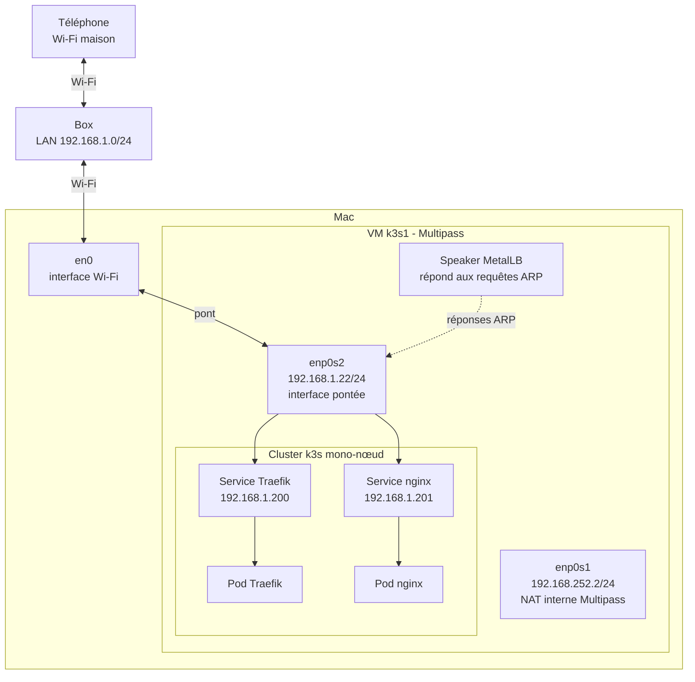
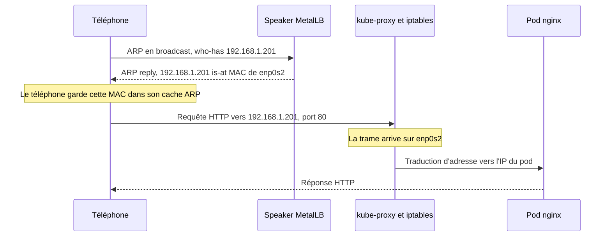

# Lab MetalLB L2 sur un réseau domestique

Ce lab teste MetalLB en mode L2 depuis un Mac. Un service Kubernetes reçoit une IP du réseau de la maison. Un téléphone sur le Wi-Fi peut ensuite l'atteindre.

## Sommaire

- [Objectif](#objectif)
- [Architecture](#architecture)
- [Comment fonctionne MetalLB en mode L2](#comment-fonctionne-metallb-en-mode-l2)
- [Prérequis](#prérequis)
- [Étapes pas à pas](#étapes-pas-à-pas)
- [Observer le mécanisme](#observer-le-mécanisme)
- [Troubleshooting](#troubleshooting)
- [Limites et lien avec l'entreprise](#limites-et-lien-avec-lentreprise)
- [Pourquoi pas OrbStack ou Docker Desktop](#pourquoi-pas-orbstack-ou-docker-desktop)
- [Nettoyage](#nettoyage)
- [Contenu du repo](#contenu-du-repo)

## Objectif

Sur un cluster cloud, un Service `LoadBalancer` reçoit son IP du fournisseur. Sur un cluster local, personne ne la fournit : le Service reste en `<pending>`. MetalLB comble ce manque.

Ce lab vérifie trois choses :

- MetalLB attribue une IP du LAN à un Service `LoadBalancer`.
- Cette IP est joignable depuis un autre appareil du réseau.
- Le mécanisme ARP est observable avec des outils simples.

**Résultat obtenu :**

| Service | Type | IP externe |
| --- | --- | --- |
| Traefik (installé par défaut par k3s) | `LoadBalancer` | `192.168.1.200` |
| nginx | `LoadBalancer` | `192.168.1.201` |

Test validé : `http://192.168.1.201` est accessible depuis un téléphone sur le Wi-Fi de la maison.

## Architecture

La VM a deux interfaces. Seule `enp0s2` est sur le réseau de la box.



## Comment fonctionne MetalLB en mode L2

MetalLB a deux composants :

- le **controller** attribue une IP du pool à chaque Service `LoadBalancer` ;
- le **speaker** annonce cette IP sur le réseau. Il tourne sur chaque nœud.

Le point important : **l'IP n'existe sur aucune carte réseau.**

- Le speaker ne crée pas d'interface.
- Il n'ajoute pas l'IP sur `enp0s2`.
- Il écoute les requêtes ARP sur le réseau.
- Il répond à celles qui concernent une IP du pool, avec la MAC de l'interface existante du nœud.

Pour le réseau, le nœud semble donc posséder l'IP. Les paquets arrivent sur le nœud. kube-proxy les envoie ensuite vers un pod, grâce à ses règles iptables.



Deux règles en découlent :

- **Un seul nœud porte une IP à la fois.** MetalLB élit ce nœud pour chaque IP. Tout le trafic de cette IP passe par lui. Le mode L2 apporte donc de la haute disponibilité, pas une vraie répartition de charge entre nœuds.
- **Le failover passe par du gratuitous ARP.** Si le nœud tombe, un autre nœud reprend l'IP. Il envoie un ARP non sollicité pour que le réseau mette à jour la MAC associée.

> Ce lab n'a qu'un seul nœud. Le failover est expliqué ici, mais il n'a pas été testé.

## Prérequis

- Un Mac connecté au Wi-Fi sur l'interface `en0`.
- [Multipass](https://multipass.run/) installé.
- Une plage d'IP libre sur le LAN, **hors de la plage DHCP de la box**. Ici : `192.168.1.200-192.168.1.210`.
- Un téléphone sur le même Wi-Fi pour le test final.

Vérifiez que Multipass voit l'interface `en0` :

```bash
multipass networks
```

Si votre réseau n'est pas en `192.168.1.0/24`, adaptez le pool dans [`manifests/metallb-pool.yaml`](manifests/metallb-pool.yaml).

## Étapes pas à pas

Les étapes 2 à 5 sont automatisées par [`scripts/install.sh`](scripts/install.sh). Le script peut être relancé sans risque. Le déroulé manuel reste utile pour comprendre chaque étape.

### 1. Créer la VM (sur le Mac)

```bash
multipass launch --name k3s1 --cpus 2 --memory 2G --disk 15G --network en0
```

`--network en0` crée l'interface pontée. `--disk 15G` est indispensable : voir [Troubleshooting](#troubleshooting).

**Vérification :** la VM doit avoir une IP sur `enp0s1` et une IP du LAN sur `enp0s2`.

```bash
multipass exec k3s1 -- ip -br -4 addr
```

Valeurs du lab : `enp0s1` en `192.168.252.2/24` et `enp0s2` en `192.168.1.22/24`.

Copiez ensuite le repo dans la VM, puis ouvrez un shell :

```bash
multipass transfer --recursive . k3s1:/home/ubuntu/metallb-lab
multipass shell k3s1
```

**Option rapide :** lancez le script dans la VM, puis passez directement à l'[étape 6](#6-tester-depuis-le-téléphone).

```bash
cd ~/metallb-lab
./scripts/install.sh
```

### 2. Installer k3s (dans la VM)

```bash
curl -sfL https://get.k3s.io | sh -s - --disable servicelb
```

`--disable servicelb` retire le load balancer intégré à k3s. MetalLB peut ainsi gérer seul les Services `LoadBalancer`.

Rendez ensuite `kubectl` utilisable sans `sudo` :

```bash
mkdir -p ~/.kube
sudo install -m 600 -o "$(id -u)" -g "$(id -g)" /etc/rancher/k3s/k3s.yaml ~/.kube/config
export KUBECONFIG=~/.kube/config
```

**Vérification :** le nœud `k3s1` doit être `Ready`.

```bash
kubectl get nodes
```

### 3. Installer Helm et MetalLB

```bash
curl -fsSL https://raw.githubusercontent.com/helm/helm/main/scripts/get-helm-3 | bash

helm repo add metallb https://metallb.github.io/metallb
helm repo update metallb
helm upgrade --install metallb metallb/metallb \
  --namespace metallb-system --create-namespace
```

La version du chart n'est pas figée : vous obtenez la dernière version publiée.

**Vérification :** le controller et le speaker doivent être `Running`.

```bash
kubectl -n metallb-system get pods
```

### 4. Déclarer le pool d'adresses

```bash
cd ~/metallb-lab
kubectl apply -f manifests/metallb-pool.yaml
```

Ce fichier contient deux objets :

- l'`IPAddressPool` **maison** définit les IP utilisables ;
- la `L2Advertisement` **maison** demande de les annoncer en mode L2.

Une erreur de webhook peut apparaître juste après l'installation. Attendez que le controller soit prêt et relancez la commande.

**Vérification :** Traefik doit recevoir `192.168.1.200`.

```bash
kubectl -n kube-system get svc traefik
```

### 5. Déployer nginx

```bash
kubectl apply -f manifests/nginx.yaml
```

MetalLB attribue la première IP libre du pool. Déployez donc nginx après l'attribution de l'IP de Traefik pour retrouver la même répartition.

**Vérification :** le Service nginx doit recevoir `192.168.1.201`.

```bash
kubectl get svc nginx
```

### 6. Tester depuis le téléphone

Sur un téléphone connecté au Wi-Fi de la maison, ouvrez `http://192.168.1.201`.

**Vérification :** la page d'accueil de nginx s'affiche.

## Observer le mécanisme

### Sur le Mac : une seule MAC pour trois IP

Générez d'abord du trafic pour remplir le cache ARP :

```bash
ping -c 1 192.168.1.22
curl -s -o /dev/null -m 3 http://192.168.1.200
curl -s -o /dev/null -m 3 http://192.168.1.201
```

Utilisez `curl` pour les IP MetalLB : elles ne répondent pas forcément au ping. Ici, seul compte le contenu du cache ARP.

Lisez ensuite le cache :

```bash
arp -an | grep -E '192\.168\.1\.(22|200|201)\)'
```

Forme attendue, avec la **même MAC** sur les trois lignes :

```text
? (192.168.1.22) at <MAC_enp0s2> on en0 ...
? (192.168.1.200) at <MAC_enp0s2> on en0 ...
? (192.168.1.201) at <MAC_enp0s2> on en0 ...
```

Comparez avec la MAC de `enp0s2` dans la VM :

```bash
multipass exec k3s1 -- ip -br link show enp0s2
```

`arp` sur macOS retire les zéros en tête de chaque octet. Par exemple, `0a` reste `a`. Tenez-en compte pour comparer les deux valeurs.

### Dans la VM : les échanges ARP

Lancez la capture dans la VM :

```bash
sudo tcpdump -ni enp0s2 arp
```

Depuis le Mac, videz l'entrée ARP, puis relancez une requête :

```bash
sudo arp -d 192.168.1.201
curl -s -o /dev/null -m 3 http://192.168.1.201
```

Forme attendue dans la capture :

```text
ARP, Request who-has 192.168.1.201 tell <IP_CLIENT>, ...
ARP, Reply 192.168.1.201 is-at <MAC_enp0s2>, ...
```

### Dans la VM : l'IP n'est sur aucune carte

```bash
ip -br -4 addr
```

`192.168.1.200` et `192.168.1.201` n'apparaissent pas. C'est le comportement normal du mode L2.

Les règles de kube-proxy, elles, mentionnent bien l'IP :

```bash
sudo iptables-save -t nat | grep 192.168.1.201
```

Pour voir quel nœud annonce l'IP, regardez les événements du Service :

```bash
kubectl describe svc nginx
```

## Troubleshooting

### Pods MetalLB `Evicted` ou `Pending` : disque trop petit

**Symptômes**

- Les pods MetalLB sont `Evicted` ou `Pending`.
- Le nœud porte le taint `node.kubernetes.io/disk-pressure:NoSchedule`.

**Cause**

Sans `--disk`, Multipass crée un disque d'environ 5 Go, soit 3,9 Go utiles. Dans ce lab, le kubelet est passé en `DiskPressure` à 86 % d'utilisation. Il a posé le taint et évincé les pods.

Ce 86 % est une valeur observée. Le seuil réel dépend de la configuration du kubelet. Voir la [documentation Kubernetes sur l'éviction](https://kubernetes.io/docs/concepts/scheduling-eviction/node-pressure-eviction).

**Diagnostic**

```bash
df -h /
kubectl describe node k3s1 | grep -E 'Taints|DiskPressure'
kubectl -n metallb-system get pods
```

**Correction**

Sur le Mac, agrandissez le disque :

```bash
multipass stop k3s1 && multipass set local.k3s1.disk=15G && multipass start k3s1
```

Dans la VM, supprimez les pods en échec :

```bash
kubectl -n metallb-system delete pod --field-selector=status.phase=Failed
```

**Vérification :** `df -h /` montre la nouvelle taille, le taint a disparu et les pods sont `Running`.

## Limites et lien avec l'entreprise

Ce lab fonctionne car le pool et le nœud sont sur le même réseau. Cette condition est la vraie limite du mode L2.

**Le pool doit être dans le même domaine L2 qu'une interface du nœud.** ARP ne traverse pas un routeur. Si personne ne reçoit la requête ARP, le speaker ne peut pas y répondre.

**Sur VMware**, si le pool est sur un autre VLAN que les nœuds, il faut amener ce VLAN jusqu'à la VM :

- une 2e vNIC sur le port group de ce VLAN ;
- ou un port group en trunk.

Ces deux options sont souvent interdites par les policies de l'entreprise.

**Avec NSX**, SpoofGuard et IP Discovery peuvent aussi bloquer le trafic. Ces fonctions contrôlent les couples IP/MAC vus sur un port. Or l'IP du Service n'est pas une IP déclarée de la VM.

**Alternatives :**

| Option | Principe | À vérifier |
| --- | --- | --- |
| Pool dans le subnet des nœuds | Le mode L2 fonctionne sans VLAN supplémentaire | Réserver la plage auprès de l'équipe réseau |
| Mode BGP | Les nœuds annoncent les IP aux routeurs | Accord et configuration côté réseau |
| LB natif de la plateforme | Le fournisseur de la plateforme gère l'IP | Disponibilité sur la plateforme |

## Pourquoi pas OrbStack ou Docker Desktop

Ces outils n'ont pas de mode pont. Leur réseau n'est pas visible depuis le LAN. Un téléphone ne recevrait donc jamais les réponses ARP du speaker.

Multipass, avec `--network en0`, place la VM directement sur le réseau de la box. Le test depuis le téléphone devient possible.

## Nettoyage

Sur le Mac :

```bash
multipass delete --purge k3s1
```

Cette commande supprime définitivement la VM et son cluster.

## Contenu du repo

```text
.
├── LICENSE
├── README.md
├── manifests/
│   ├── metallb-pool.yaml   # IPAddressPool et L2Advertisement
│   └── nginx.yaml          # Deployment et Service LoadBalancer
└── scripts/
    └── install.sh          # Installation idempotente, à lancer dans la VM
```

## Licence

[MIT](LICENSE)
